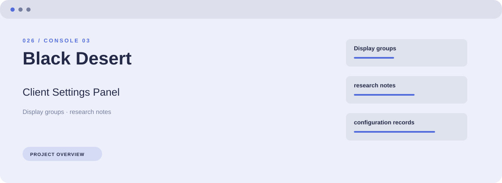
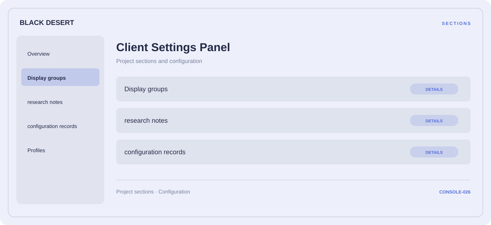

# ⚡ Black Desert Client Settings Panel

**Display groups · Research notes · Configuration records**

## ⚡ Features

Start with display groups, organize research notes, and keep configuration records close at hand. These are the main areas covered by Black Desert Client Settings Panel.

### ⚙️ Display groups

Display or performance-related options, with space for configuration and comparison information.

### 🧩 Research notes

A dedicated section for research notes and the configuration details associated with that area.

### ⌨️ Configuration records

A dedicated section for configuration records and the configuration details associated with that area.

## 🖥️ Project navigation

## 📥 Download

The button and cover open the project's download page. Use the information supplied with the downloaded package for installation and release-specific requirements.

## 📚 Project documentation

- [Feature reference](docs/FEATURES.md)
- [Download information](docs/DOWNLOAD.md)
- [Project page](index.html)

---

Black Desert Client Settings Panel · Program documentation and download information.
                                                                                                    